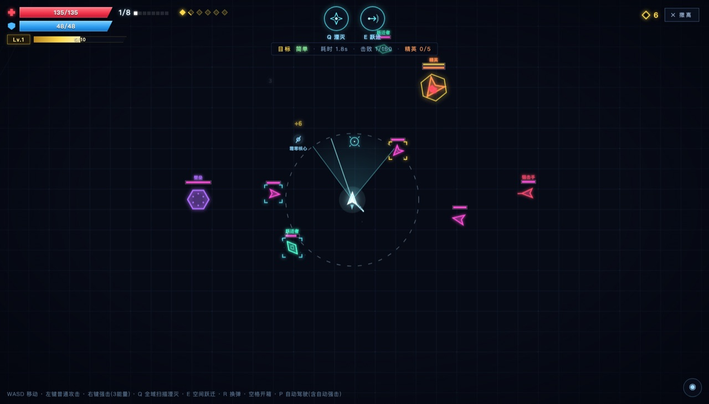
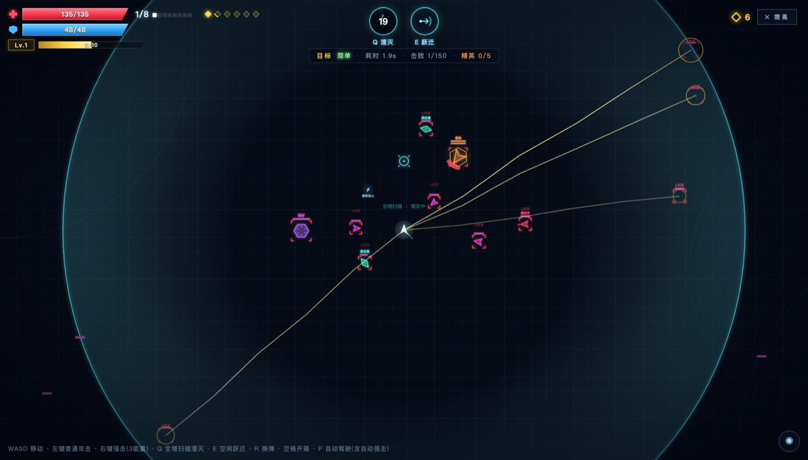

# VECTOR // ARENA

**霓虹弹幕 · 生存竞技场**

一款单文件、零依赖的 HTML5 Canvas 霓虹弹幕生存游戏。驾驶矢量战机，在无限竞技场中扫描、锁定、跃迁，用枪械、技能与永久成长对抗不断增强的敌群。

**[在线试玩](https://congfeng12.github.io/vector-arena/)** · **[GitHub 仓库](https://github.com/congfeng12/vector-arena)**



## 游戏特色

- **单文件运行**：完整游戏包含在 `triangle-arena.html` 中，不需要安装依赖或构建。
- **高速弹幕战斗**：自动连发、穿透强击、多弹丸、浮游炮、追踪弹、弧线激光与元素核心叠加。
- **空间技能**：Q 全域扫描湮灭与 E 空间跃迁，均带有暂停、镜头拉远和全屏演出。
- **永久成长**：天赋、技能等级、抽卡装备、装备词条与皮肤在多局之间保留。
- **局内构筑**：击杀升级、随机道具、属性核心、神秘宝箱共同决定每一局的打法。
- **自适应性能**：根据实体数量动态调整辉光、粒子与绘制细节，并对弹幕和伤害数字做合并与限流。
- **自动存档**：localStorage + IndexedDB 双通道保存，支持 `file://` 本地直接打开。

## 操作

| 输入 | 功能 |
| --- | --- |
| `WASD` / 方向键 | 移动 |
| 鼠标移动 | 瞄准 |
| 鼠标左键（按住） | 普通攻击，自动连发；弹匣打空后自动装填 |
| 鼠标右键 | 强力攻击，金色穿透弹，消耗 3 点能量 |
| `R` | 手动装填弹匣 |
| `P` | 自动驾驶 / 自动攻击 / 自动强击开关（Q、E 仍需手动释放） |
| `空格` | 开启扫描范围内的神秘宝箱 |
| `Q` | 全域扫描湮灭 |
| `E` | 空间跃迁 |
| `Esc` / 鼠标右键 | 取消正在瞄准的跃迁 |

## 玩法目标

一局的目标是同时完成：

- 击败 **150** 个敌人
- 消灭 **5** 个精英敌人

没有存活时间限制。通关耗时越短，结算时获得的时间奖励材料越多，并会给出 S / A / B / C 评级。通关后会显示本局数据报表，包括击杀明细、拾取道具、宝箱效果、总输出与承伤等。

难度分为简单、困难、地狱，可在设置页切换；难度会影响敌人血量、伤害、攻击欲望和材料奖励。

## 技能

### Q · 全域扫描湮灭

暂停时间并把镜头拉远，扩展视野中会涌入增援敌人。扫描波由内向外扩张，掠过的敌人先被方形扫描框标记锁定，扫描覆盖全屏后按锁定顺序逐个射出处决光束击杀，同时清除敌方弹幕。

### E · 空间跃迁

暂停并拉远镜头展开扫描，移动鼠标选择落点。点击左键确认后播放空间折叠特效，角色快速跃迁到鼠标位置；右键或 `Esc` 可取消。等级越高冷却越短。



## 敌人

| 敌人 | 特点 |
| --- | --- |
| 猎犬 | 基础近战敌人，速度中等 |
| 射手 | 保持中距离发射弹幕 |
| 快速 | 速度极快、血量很低 |
| 狙击手 | 远距离高速精准射击 |
| 壁垒 | 移动极慢、血量厚、撞击伤害高 |
| 跃迁者 | 移动极慢，每隔约 5 秒空间跃迁到主角身边 |
| 精英 | 带金色护盾和高密度弹幕，攻击欲望高 |

特殊敌人会在血条上方显示名称与同步等级。所有敌人会随玩家局内等级提升而同步变强。

## 永久成长

### 天赋

使用击杀获得的材料永久升级 15 个天赋节点，覆盖伤害、射速、射程、暴击、生命、护甲、弹匣、能量、冷却、移速、拾取、扫描、装填等方向。

### 装备与抽卡

- 抽卡可获得绿 / 蓝 / 橙 / 红四种品质的属性装备，以及角色皮肤。
- 装备主属性包括伤害、射速、射程、弹道数量和浮游炮数量。
- 装备可升级、添加或刷新附加词条；最多同时装备 4 件。
- 背包支持单件删除与批量选择删除，已装备道具不会被批量删除。

### 皮肤

抽卡可解锁 6 种机体配色，仅改变外观，不影响战斗属性。

## 局内成长

- 击杀敌人获得经验并升级，升级会立即回复生命与护甲，同时提升本局基础伤害；死亡或撤离后重置。
- 击杀掉落各类临时道具：射速、多重弹道、浮游炮、追踪弹、维修、装甲、能量、弹头强化、扫描扩展、快速装填、弧线激光等。
- 拾取烈焰、闪电、霜寒、剧毒属性核心可叠加层数，不同属性可以共存，命中时同时触发。
- 神秘宝箱会在战斗中随机出现，进入扫描范围后按空格开启，获得 10 秒未知的增益或减益。

## 运行方式

### 在线

打开：**https://congfeng12.github.io/vector-arena/**

根地址会通过 `index.html` 自动跳转到游戏本体。

### 本地

直接双击打开：

- `index.html`（自动跳转）
- 或 `triangle-arena.html`（游戏本体）

也可以启动一个静态服务器：

```bash
python3 -m http.server 8000
```

然后访问 `http://localhost:8000/`。

> 存档按浏览器来源隔离，本地 `file://`、`localhost` 和线上 Pages 各自拥有独立进度。

## 项目结构

```text
.
├── index.html           # GitHub Pages 入口，自动跳转到游戏
├── triangle-arena.html  # 游戏本体（HTML + CSS + JavaScript）
├── screenshot.jpg       # 战斗画面
└── screenshot-q.jpg     # Q 技能画面
```

## 技术实现

- 原生 HTML / CSS / JavaScript，无框架、无外部资源。
- Canvas 2D 渲染，WebAudio 程序化音效。
- 高 DPR 自适应渲染、离屏精灵缓存、视口裁剪。
- 动态画质：根据敌人、弹幕、粒子和浮字数量自动降低辉光与特效开销。
- 性能保护：敌弹总量限制、粒子上限、伤害数字合并、状态提示节流、死亡残影限制。
- 存档：localStorage 主存储 + IndexedDB 镜像兜底，启动时按时间戳恢复较新存档。

## 兼容性

推荐使用桌面版 Chrome / Edge，键盘与鼠标操作。现代 Safari、Firefox 也可运行；暂未适配触屏移动端。

## 开发调试

游戏没有构建步骤，直接编辑 `triangle-arena.html` 并刷新页面即可。控制台提供少量调试入口，例如：

```js
window.__dbg()                    // 查看当前战斗状态
window.__go()                     // 直接开始一局
window.__addMat(1000)             // 增加材料
window.__spawnEnemy('warp', 300)  // 在指定相对位置生成敌人
```

游戏内也提供作弊面板，可用于本地测试天赋、技能、装备与属性加成。
